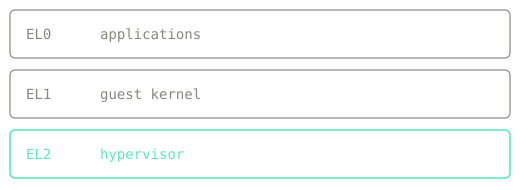

This page is a reference while you write. Open it next to the post you're working on.

## Headings

````markdown
## Section          appears in the contents sidebar
### Subsection      appears in the contents sidebar
#### Small label    not listed
````

Hover a heading to get its `##` link. On wide screens the contents list on the right tracks your position; on narrow screens it folds above the text.

### A subsection

#### A small label

Body text follows.

## Code typed into the post

### Plain

````markdown
```c
int x = 42;
```
````

```c
int x = 42;
```

### With a filename bar, line numbers and highlighted lines

````markdown
```c {title="vm.c" linenos=true hl_lines="3-4"}
...
```
````

```c {title="vm.c" linenos=true hl_lines="3-4"}
#include <Hypervisor/Hypervisor.h>

hv_return_t r = hv_vm_create(NULL);
if (r != HV_SUCCESS) return 1;
```

### A shell session

Lines starting with `$ ` are commands. The copy button copies only those, without the prompt or output.

````markdown
```console
$ make 01-hello
$ ./01-hello
exit reason 1
```
````

```console
$ make 01-hello
clang -Wall -O1 01-hello.c -o 01-hello -framework Hypervisor
$ ./01-hello
exit reason 1
```

### A diff

```diff {title="vm.c"}
-    CHECK(hv_vm_create(NULL));
+    hv_vm_config_t cfg = hv_vm_config_create();
+    CHECK(hv_vm_create(cfg));
```

## Code from a file

Point at a file in `code/` instead of pasting it. The post then can't drift from the program, and the build stops with a clear message if a file, region or range goes missing. The file name in the bar links to the exact lines on GitHub.

### A marked region

Mark the region in the source, on lines of their own:

```c
    // [blog:create]
    CHECK(hv_vm_create(NULL));
    ...
    // [/blog:create]
```

then point at it:

````markdown

````



Common indentation is removed and line numbers follow the file.

### A line range, with emphasis

`hl` counts lines of the snippet, starting at 1.

````markdown

````



Other options: `title="..."`, `lang="c"`, `linenos=false`.

## Callouts

They use GitHub's syntax, so the Markdown renders on github.com too.

````markdown
> [!NOTE]
> Body text.

> [!HOOD] Under the hood
> A custom type with its own title.

> [!EXERCISE]- Try it
> Folded until clicked. Use + to start open.
````

> [!NOTE]
> A note.

> [!TIP]
> A tip.

> [!IMPORTANT]
> Something the reader must not miss.

> [!WARNING]
> A warning.

> [!CAUTION]
> Something that breaks things.

> [!HOOD] Under the hood
> For the detail beneath the detail.

> [!SPEC]
> A quotation from a reference manual.

> [!EXERCISE]- Try it
> Folded until clicked.

## Register layout

````markdown

34 | E2H | ...
31 | RW  | ...

````


34 | E2H | EL2 hosts an operating system (VHE)
31 | RW  | EL1 is AArch64
27 | TGE | EL0 exceptions go to EL2
19 | TSC | trap `SMC` to EL2
0  | VM  | enable stage-2 translation


Bits are `n` or `hi:lo`. Fields named `RES0` or `RES1` are hatched. Use `width=32` for 32-bit registers.

## Images

Put the file next to `index.md`. PNG and JPEG sizes are read at build time, so nothing jumps while they load. SVG scales to the column.

````markdown

````


## Tables

| Level | Runs            | Here      |
|:------|:----------------|----------:|
| EL0   | applications    | `./guest` |
| EL1   | kernels         | Linux     |
| EL2   | hypervisors     | HVF       |

## Small things

Inline `code`, keys like <kbd>⌘</kbd> <kbd>C</kbd>, *emphasis*, **strong**, and a footnote.[^fn]

Links to other pages can use the folder path, e.g. `[part 00a](/series/hvf/00a-first-vm/)`, and a link that doesn't resolve prints a warning while `make dev` runs.

<details>
<summary>A plain fold</summary>

Content inside a `<details>` element.
</details>

[^fn]: Footnotes collect at the end of the post.
